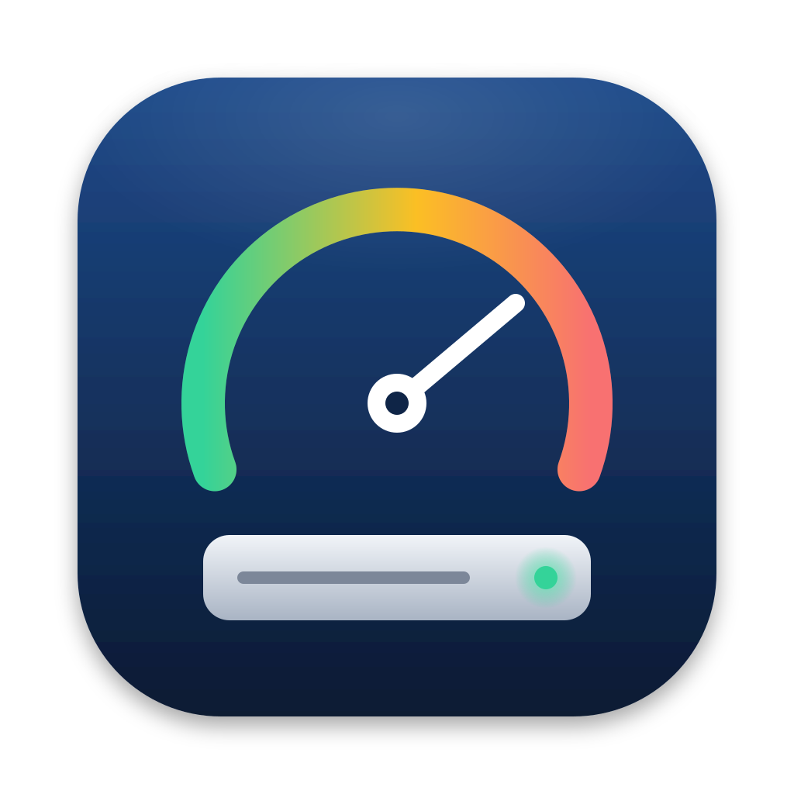
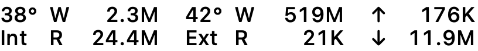

<p align="center">
  
</p>

<h1 align="center">Disk &amp; Wi-Fi Monitor · 硬盘和 Wi-Fi 监控</h1>

<p align="center">
  在 macOS 状态栏实时显示硬盘的温度、读写速度、健康度、剩余空间，以及网络上行和下行速度。<br>
  Real-time disk temperature, read/write speed, health, free space and network speed in your Mac menu bar.
</p>

<p align="center">
  
</p>

[English](#english) · [下载 / Download](https://github.com/minder-z/disk-monitor-mac/releases/latest)

---

## 功能

- **状态栏实时显示**：每块硬盘显示温度和每秒的读取、写入速度，可以单独隐藏某块盘
- **网速**：状态栏显示实时上行 ↑ 和下行 ↓ 速度，菜单里显示累计流量，可以关闭
- **详细信息菜单**：型号、温度、健康状态、寿命已用、累计写入、通电时长、非正常关机次数
- **空间信息**：每个卷的已用、总容量和可用空间，配用量条（超过 80% 变橙色，超过 90% 变红色）
- **外置硬盘**：一键推出、卸载、重新挂载；推出后会通知"可以安全拔出"
- **提醒**：温度过高（≥ 70°C）、SMART 健康检查未通过、寿命已用 ≥ 90% 时发送系统通知
- **8 种语言**：简体中文、繁體中文、English、日本語、한국어、Deutsch、Français、Español，可在菜单中随时切换
- **开机自动启动**
- **开箱即用**：内置 smartctl，不需要另外安装 smartmontools，不需要管理员权限

## 系统要求

| 机型 | 最低系统 |
|---|---|
| Intel Mac | macOS 10.15 Catalina |
| Apple 芯片 Mac（M1 及以后） | macOS 11 Big Sur |

## 安装

1. 到 [Releases](https://github.com/minder-z/disk-monitor-mac/releases/latest) 下载 `DiskMonitor-x.x.dmg`
2. 打开 DMG，把 **DiskMonitor** 拖到 **Applications（应用程序）** 文件夹
3. **首次打开**：本应用没有经过 Apple 公证，系统会拦截一次，放行方法如下：
   - **macOS 15 及以上**：先双击打开一次并点"完成" → "系统设置 → 隐私与安全性" → 在页面下方点 **仍要打开**
   - **macOS 10.15 – 14**：按住 Control 键点按应用（或右键）→ **打开** → 再点 **打开**
   - 如果提示"已损坏"，在终端运行：
     ```bash
     xattr -dr com.apple.quarantine /Applications/DiskMonitor.app
     ```

应用只出现在屏幕右上角的状态栏，不会出现在程序坞（Dock）中。

## 说明与限制

- 读写速度、空间信息通过系统接口读取，所有硬盘都支持。
- 温度和健康度来自硬盘的 SMART 数据。部分 USB 硬盘盒不支持透传 SMART，这种情况下只显示速度和空间。
- Apple 芯片 Mac 的内置 SSD 只提供部分 SMART 信息，属于系统限制。

## 从源码编译

需要 Xcode 命令行工具（Swift 5.9 及以上）。

```bash
./build.sh              # 编译通用版（Apple 芯片 + Intel），生成 build/DiskMonitor.app
./tools/make_dmg.sh     # 编译并打包成 build/DiskMonitor-<版本>.dmg
```

| 路径 | 内容 |
|---|---|
| `Sources/DiskMonitor/` | Swift 源码 |
| `tools/gen_strings.py` | 所有翻译文字；改翻译或加语言只改这里 |
| `tools/build_smartctl.sh` | 从官方源码重新编译内置的 smartctl（升级版本时用） |
| `Vendor/smartmontools/` | 内置的 smartctl 及其 GPL 许可证 |
| `Assets/` | 图标源文件 |

## 许可证

- 本项目代码使用 [MIT 许可证](LICENSE)。
- 内置的 `smartctl` 来自 [smartmontools](https://www.smartmontools.org) 7.5，未作修改，使用 GNU GPL v2 许可证，见 [Vendor/smartmontools](Vendor/smartmontools)。

---

## English

**Disk & Wi-Fi Monitor** is a lightweight macOS menu bar app that shows your network speed and, for every internal and external disk:

- Temperature and live read/write speed right in the menu bar
- Network upload ↑ / download ↓ speed in the menu bar, plus total traffic
- Health (SMART), life used, total data written, power-on hours, unsafe shutdowns
- Used / total / free space for each volume, with a usage bar
- Eject, unmount and mount for external disks
- Notifications for high temperature (≥ 70°C), failed SMART health checks, and ≥ 90% life used
- 8 languages (switchable in the menu), launch at login
- `smartctl` is bundled, so nothing else to install and no admin rights needed

**Requirements:** macOS 10.15+ on Intel, macOS 11+ on Apple silicon.

**Install:** download the DMG from [Releases](https://github.com/minder-z/disk-monitor-mac/releases/latest) and drag the app to Applications. The app is not notarized, so on first launch:
- **macOS 15+:** open it once, click "Done", then go to System Settings → Privacy & Security and click **Open Anyway**.
- **macOS 10.15 – 14:** Control-click the app → **Open** → **Open**.
- If macOS says the app is damaged, run `xattr -dr com.apple.quarantine /Applications/DiskMonitor.app`.

**Build:** `./build.sh` (universal app) or `./tools/make_dmg.sh` (DMG).

**License:** MIT for this project. The bundled `smartctl` (smartmontools 7.5, unmodified) is GPL-2.0; see [Vendor/smartmontools](Vendor/smartmontools).
